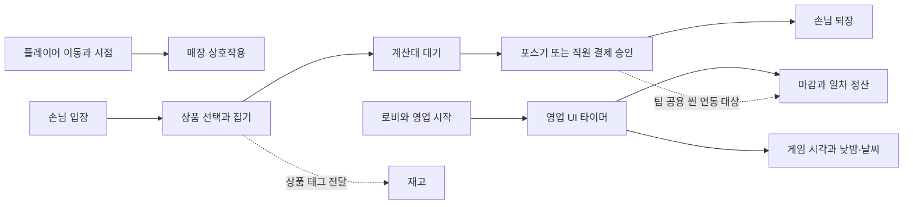

# 6팀 중간발표 · 하종욱 담당 진행 현황

발표 11월 30일(월) · 자료 기준 2026년 11월 25일  
담당 범위: 카메라·이동, 시간·환경, 손님·행인 NPC

## 1. 주제와 주요 기능

도시 편의점에서 플레이어가 매장을 운영하고 직원에게 업무를 지시하는 게임이다. 하종욱 담당은 플레이어가 매장을 움직이고, 영업 시간이 흐르는 동안 손님이 방문해 물건을 고르고 계산한 뒤 나가는 하루의 흐름을 구현하는 부분이다.

| 시스템 | 현재까지 구현한 내용 | 발표에서 보여줄 장면 |
| --- | --- | --- |
| 카메라·이동 | WASD 이동, 마우스 시점, UI에 따른 커서 잠금 전환. 직원의 NavMesh 목적지 이동과 도착·실패·취소 결과 전달 | 매장을 이동하다 UI를 열고 닫은 뒤 조작 복귀 |
| 시간·환경 | 영업 UI의 남은 시간과 게임 시각 동기화, 낮·밤과 태양·달·구름 변화, 비·안개 강도 설정, 마감 및 다음 일차 연결 | 영업 시간이 흐르면서 하늘이 바뀌고 정산으로 넘어가는 장면 |
| 손님·행인 NPC | 보도에서 생성되는 손님과 행인 분리, 손님 행동 6종, 상품 예약·집기, 계산 줄과 대기 시간, 외부 결제 API, 퇴장 후 1~5초 재생성 간격 | 파란 Capsule 행인은 보도를 지나가고, 빨간 Capsule 손님은 입장해 상품을 고른 뒤 계산대에 줄을 서는 장면 |

## 2. 제안 발표 대비 구체화된 내용

손님이 모두 같은 상품 동선을 따르던 구조를 여섯 유형으로 구분했다. 진열대로 바로 가는 손님, 통로에서 잠시 고민하는 손님, 매장 안쪽에서 더 오래 선택을 망설이는 손님, 상품을 못 찾으면 직원이나 플레이어에게 묻는 손님, 못 찾으면 빈손으로 나가는 손님, 입장 지점에서 잠시 머물다가 구매 없이 나가는 손님이 있다. 품절 상황과 손님 유형에 따라 구매를 건너뛸 수 있다.

계산은 손님이 계산대에 도착해 대기하고, 실제 연동 모드에서는 포스기나 직원에서 승인해야 완료되는 구조로 바꿨다. 상품을 집을 때 재고 시스템에 카테고리 태그를 전달하고, 결제가 확정됐을 때 매출과 정산을 반영하는 역할을 분리했다. LLM 구조 변경에 대한 설명은 팀 발표 자료의 해당 담당 파트에서 다룬다.

## 3. 전체 시스템 구조

## 4. WBS 기준 진행 상황과 남은 작업

- 카메라·이동과 시간 UI 연결은 구현했고 Unity 검증 씬에서 조작 복귀, 시간 동기화, 마감 및 다음 일차 전환을 확인했다.
- 손님·행인 행동과 외부 결제 API, 인수인계서를 작성해 `develop`에 병합했다. 테스트 씬에서 손님별 이동·집기·대기·퇴장과 외부 결제 대기를 검증했다. 공개용 상품 프리팹 교체와 리팩토링 이후에는 컴파일을 확인했으며, 최종 씬의 플레이 재검증은 남아 있다.
- 최근 회의에서 정한 대로 하종욱의 손님 업무와 송재명의 직원·플레이어 업무를 서로 연결해 검증한다. 플레이어가 포스기로 직접 계산하는 경우와 직원이 계산하는 경우에 각각 대기 해제·판매 내역·퇴장을 확인한다. 실제 매장 재고, 영업 마감 시 신규 유입 차단과 진행 중 거래 정리도 확인한다.
- 하종욱 담당 기반 기술은 Unity NavMesh와 프로젝트의 시간·NPC 코드다. Whisper 및 OpenAI 활용은 팀 발표의 음성·직원 AI 파트에서 설명한다.

## 5. 1~2분 시연 영상용 구성

| 구간 | 화면과 전달할 내용 |
| --- | --- |
| 0:00~0:20 | 매장 이동과 시점 조작. UI를 열고 닫을 때 커서와 시점이 전환되는 모습을 보여준다. |
| 0:20~0:45 | 손님과 행인이 각각 입장 또는 보도 통과. 손님 간 동선 차이와 계산 줄을 보여준다. |
| 0:45~1:15 | 상품 집기 → 계산대 대기 → 승인 → 퇴장. 통합 검증 전에는 테스트 씬의 모의 계산 또는 테스트용 승인이라고 화면에서 표시한다. |
| 1:15~1:30 | 시간 진행과 하늘 변화, 마감 정산 전환. 시간을 압축한 촬영 설정을 사용했다면 영상에 표시한다. |

발표 멘트 예시  
“이 화면은 편의점의 하루가 실제로 어떻게 진행되는지 보여줍니다. 플레이어는 매장을 이동할 수 있고, 영업 시계에 따라 하늘과 날씨가 변합니다. 손님은 유형에 따라 바로 상품을 고르거나 고민하고, 필요한 물건을 찾지 못하면 질문하거나 나갑니다. 상품을 고른 손님은 계산대에 줄을 서며, 결제 승인 뒤 퇴장합니다. 지금은 개별 동작과 연결 API를 구현했고, 다음 단계에서 직원과 플레이어의 실제 계산 업무 및 재고·정산 흐름을 함께 검증합니다.”

참고: [카메라·이동 구현 및 인계](Systems/카메라_캐릭터이동_구현및인계.md), [시간·UI 연동 인수인계](Systems/시간_UI_연동_구현_인수인계서.md), [손님 NPC·직원·플레이어 연동 인수인계](Systems/손님NPC_직원_플레이어_연동_인수인계서.md)
